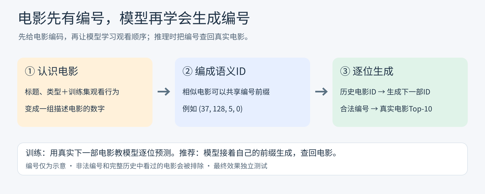

# 🎬 GENREC-demo：从电影简介到下一部电影

一个已完成的科研轮转项目，也是一份**从零理解生成式推荐**的学习仓库。基于 MovieLens 1M，完整走过数据处理、序列推荐基线、电影语义编码、生成模型训练和协同信息融合，保留代码、配置、真实日志与结果。

## 💡 这是什么？

假设一个人刚看完几部科幻电影，系统怎样推荐下一部？常见做法是给每部候选电影打分；这里尝试另一条路：**先给电影编一串有含义的编号，再让模型根据观看历史，逐位生成下一部电影的编号。**

相似电影可以共享编号前缀。模型生成完整编号后，就能查回真实电影。这里的“生成”是生成电影标识，不是编造片名或生成推荐理由。



图中编号和电影关系仅作示意。完整链路还包含训练、验证选模与测试，见[五张工作全景图](docs/workflow-atlas.md)。

## 🛤️ 七周走过了什么？

| 周次 | 做了什么 | 留下了什么 |
|---|---|---|
| Week 1 · 整理数据 | 清洗电影交互，按观看顺序划分训练、验证和测试集 | 6,040名用户、3,416部电影；[数据统计与分布图](results/week1-data-stats/stats.md) |
| Week 2 · 建立参照 | 训练两种已有的序列推荐方法：SASRec和GRU4Rec，各三个随机种子 | [基线结果](results/week2-sasrec-baseline/baseline_table.md)与原始日志 |
| Week 3–4 · 给电影编号 | 将电影简介变成384维向量，再压缩成四段语义ID；修复码本坍缩，检查冲突与语义一致性 | 3,416个唯一ID；[量化分析](results/week3-4-semantic-id/README.md)与[冻结数据接口](results/week3-4-semantic-id/05-frozen-interface/) |
| Week 5–6 · 学习生成 | 从头训练小型T5式模型，用观看历史预测下一部电影的ID；比较有／无合法编号约束的生成 | 三种子训练、分组评测与[推荐样例](results/week5-6-generative/06-reports/decode_samples.md)；[首版结果](results/week5-6-generative/06-reports/main_results.md) |
| Week 7 · 加入观看行为 | 将“电影讲了什么”和“哪些电影常被同一批人观看”结合，再生成语义ID；控制条件、验证筛选、三种子正式测试 | 四组表示消融、12项完整测试；[最终结果与统计分析](results/week7-improvement/06-evaluation/main_results.md) |

### 📊 最终效果

最近20部电影作为模型输入；全目录候选、不采样负例，屏蔽完整已看历史。以下为三个训练种子的均值 ± 总体标准差。**Recall@10**看真实下一部电影是否进入前十；**NDCG@10**还奖励更靠前的位置。

| 方法 | Recall@10 ↑ | NDCG@10 ↑ |
|---|---:|---:|
| SASRec | 0.2876 ± 0.0010 | 0.1644 ± 0.0014 |
| GRU4Rec | 0.3115 ± 0.0010 | 0.1847 ± 0.0007 |
| 生成式 · Text（纯文本） | 0.2746 ± 0.0115 | 0.1594 ± 0.0083 |
| 生成式 · Fixed（固定融合） | **0.3151 ± 0.0039** | **0.1864 ± 0.0014** |

Fixed相对受控Text的NDCG@10提高约**17.0%**。它与GRU4Rec总体接近，两者差值的95%配对区间包含0，尚不能确认超过GRU4Rec；长尾与少样本组也仍落后。生成模型使用Beam Search近似检索，基线对所有电影逐一打分。[四项指标、分组结果和置信区间](results/week7-improvement/06-evaluation/main_results.md)提供完整依据。

项目已完成。仍值得提高的方向包括：更多数据集与量化种子、真正的冷启动测试、长尾推荐，以及检索效率和线上验证。本仓库实现了语义ID生成推荐的核心链路，**不等同于TIGER论文的指标复现或生产系统**。

## 🧭 没学过推荐系统，怎么读？

不用先掌握深度学习公式。先带着一个问题读：**“系统拿到看过的电影，怎样找出下一部？”**

1. **看输入与输出。** 从[学习指南](docs/learning-guide.md)开始。“向量”是一组描述电影的数字，“语义ID”是把这组数字压缩成的编号。
2. **沿图追文件。** 打开[五张全景图](docs/workflow-atlas.md)，按数据 → 程序 → 产物的箭头阅读；每张图都标出了具体文件和用途。
3. **先看结果，再读实现。** [结果索引](results/README.md)按周折叠展示。想理解模型内部，再看[生成训练详图](docs/generative-training-diagram.md)，认识输入、目标、损失和参数更新。
4. **动手时再看配置。** [实验协议](docs/experiment-protocol.md)解释比较条件；[复现指南](docs/reproduction.md)集中提供环境与运行命令。

“基线”是用来比较的已有方法；“验证集”用于选择方案；“测试集”在方案冻结后才用于正式比较。读表时先分清这三件事，旧配置的分数不要直接与最终表混用。

## 🗂️ 目录说明

```text
.
├── scripts/       # 按 week1_、week2_、week3_4_、week5_6_、week7_ 排列的程序
├── config/        # 数据、量化与模型配置
├── docs/          # 入门、五张全景图、训练详图、协议与复现指南
├── results/       # 按周 → 阶段 → 方案/模型/种子整理的真实实验产物
├── tests/         # CPU测试：数据边界、训练恢复、评测完整性和路径规则
├── environment/   # 实验服务器的依赖版本快照
├── requirements.txt
├── CITATION.cff
└── LICENSE
```

原始数据、向量缓存和模型权重存放在实验工作区，未纳入Git；各周产物是否入库见[结果索引](results/README.md)。[服务器目录与文件对应关系](docs/server-layout.md)说明实验工作区与本仓库的连接方式。所有安装、数据准备和训练命令统一见[复现指南](docs/reproduction.md)。
