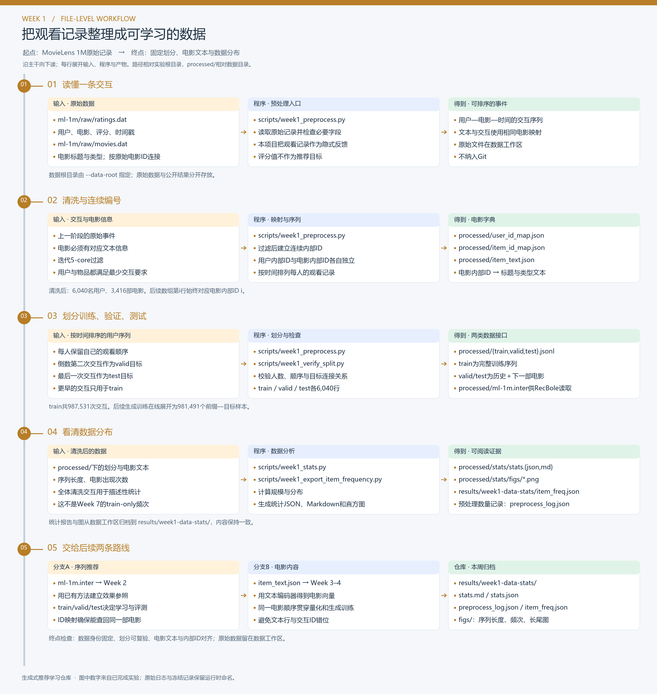
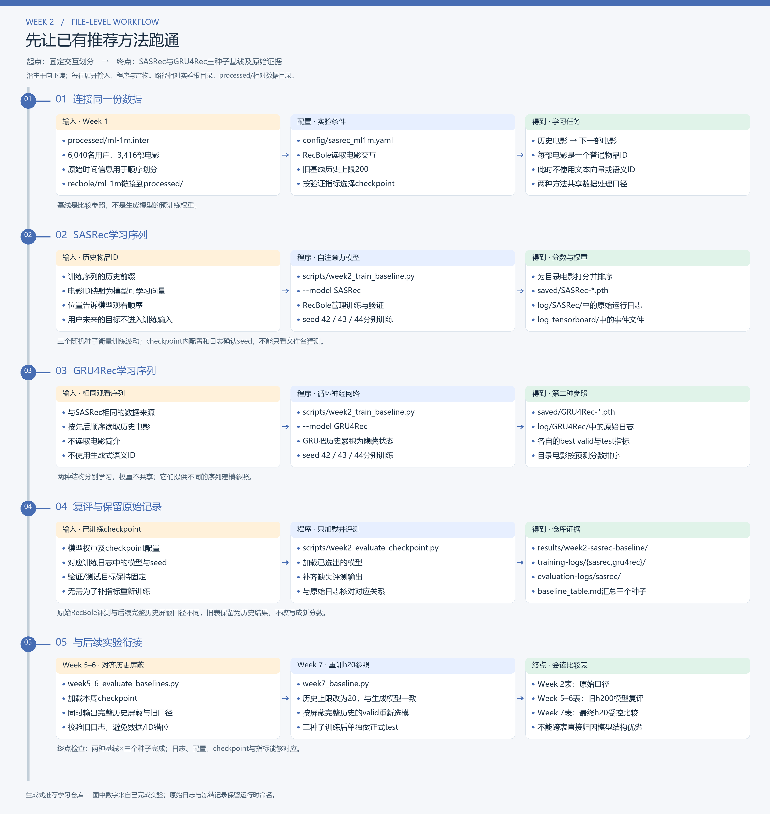
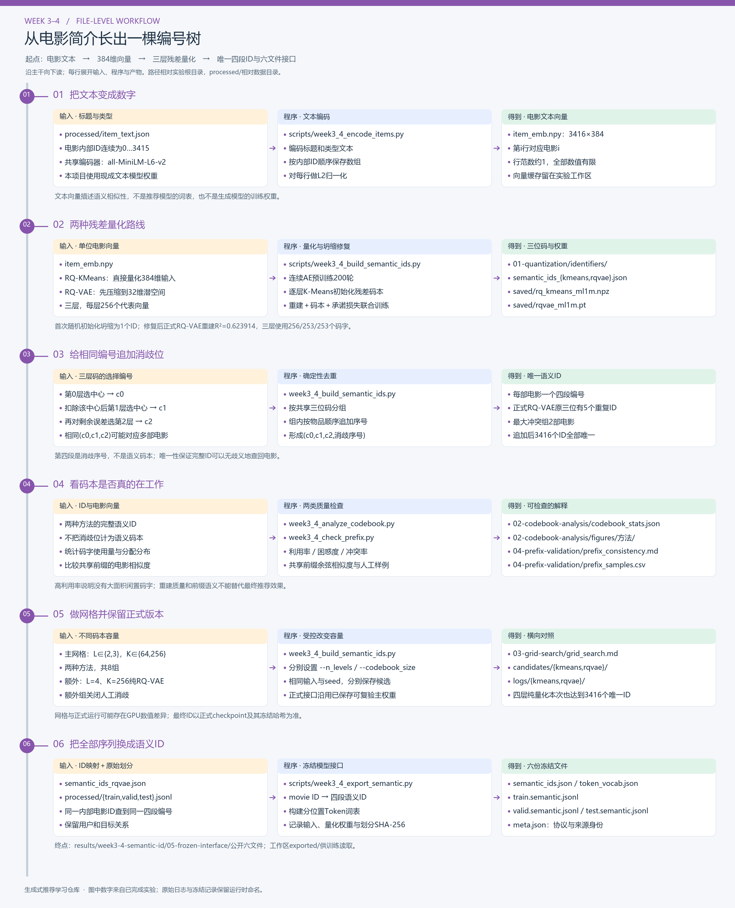
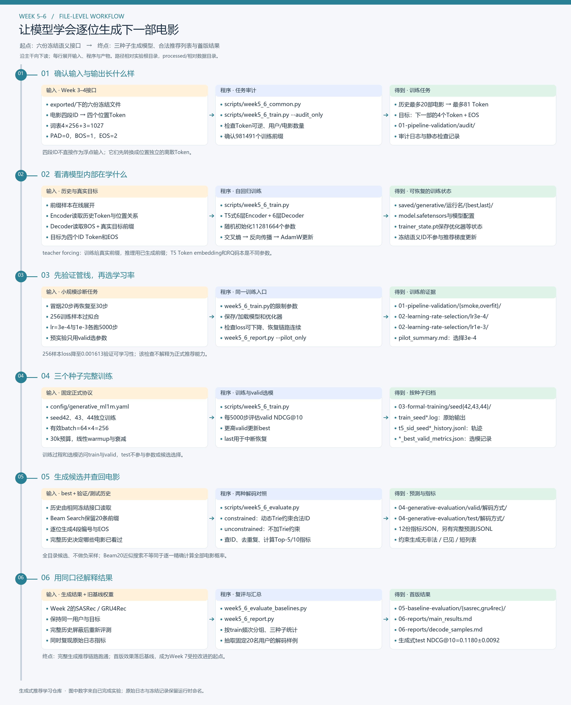
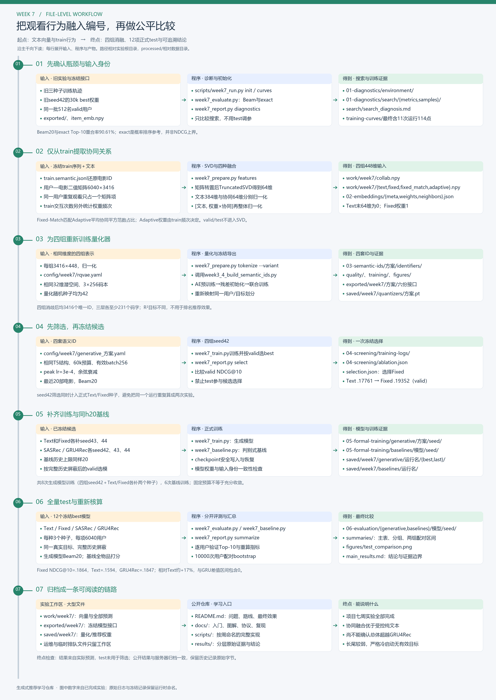

# 🌳 五张图，走完整个项目

每张图都从已有输入开始，沿主干展开“读什么 → 哪个程序处理 → 写出什么”。图中`processed/`相对数据目录，其余路径相对实验根目录；省略的共同前缀会在每周说明中注明。

**点击SVG可放大看细节。** PNG宽3,600像素，适合下载查看；图中文字和连线均由[绘图源码](assets/workflows/draw_workflows.py)生成。原始数据与大型权重留在实验工作区，Git中的结果按周归档。

## 🌱 Week 1：让原始数据变成可靠输入

从评分记录和电影信息出发，得到固定划分、连续ID、文本和数据分布。统计产物归档到[`results/week1-data-stats/`](../results/week1-data-stats/)，其余文件在数据工作区。 [放大SVG](assets/workflows/week1.svg)

## 🌿 Week 2：建立两种序列推荐参照

相同交互分别训练SASRec和GRU4Rec，各三个种子。原始结果与后续复评分开记录，避免把不同历史长度或屏蔽方式的分数混在一起。[基线表](../results/week2-sasrec-baseline/baseline_table.md) · [放大SVG](assets/workflows/week2.svg)

## 🌳 Week 3–4：把电影语义压缩成唯一编号

从384维文本向量开始，经过量化、坍缩修复、码本与前缀检查，冻结六份模型接口。图中`01-quantization/`等阶段路径共同位于`results/week3-4-semantic-id/`。[本周结果](../results/week3-4-semantic-id/README.md) · [放大SVG](assets/workflows/week3-4.svg)

## 🌲 Week 5–6：学会生成下一部电影的编号

模型读取历史电影Token，学习预测下一部电影的四个Token和结束符，再通过合法编号树得到推荐列表。阶段路径共同位于`results/week5-6-generative/`；更细的张量与梯度见[训练内部详图](generative-training-diagram.md)。[首版结果](../results/week5-6-generative/06-reports/main_results.md) · [放大SVG](assets/workflows/week5-6.svg)

## 🍃 Week 7：加入观看行为，再验证是否有效

train行为提供协同向量，四组表示重新量化、训练和筛选，最后固定候选完成12项test。阶段路径共同位于`results/week7-improvement/`，完整权重、缓存与预测另在实验工作区。[最终报告](../results/week7-improvement/06-evaluation/main_results.md) · [放大SVG](assets/workflows/week7.svg)

准备实际运行时，按[复现指南](reproduction.md)操作；图解释文件关系，协议和命令集中在文档中维护。
