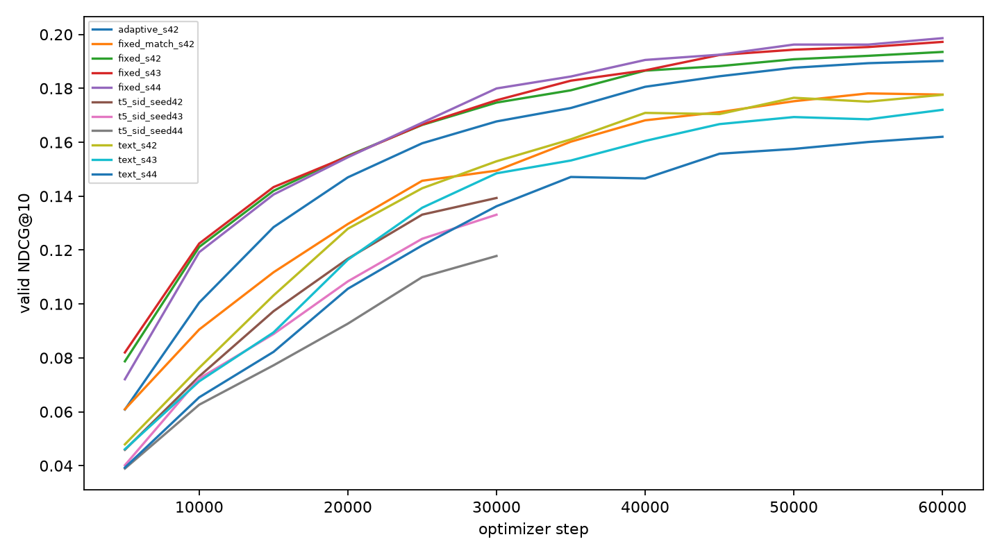

# 🔎 训练与搜索诊断

| 位置 | 内容 |
|---|---|
| [training-curves/](training-curves/) | 旧三种子＋本周8次生成模型训练，共11次运行、114个验证点；CSV与曲线图 |
| [search/search_diagnosis.md](search/search_diagnosis.md) | 旧30k模型、固定512名valid用户上的Beam／exact对比 |
| `search/metrics/`、`search/samples/` | 五种搜索方法的完整指标与20名用户样例 |
| `environment/` | 版本、输入哈希与原始代码指纹 |
| `cpu-smoke/` | 小模型前向、反向、保存与恢复记录 |

旧训练预算30k，本周60k，同时改变了表示与学习率日程。曲线不用于单独归因步数收益。Beam20与exact的Top-10平均重合率为90.61%；exact是模型概率排序参考，NDCG不保证随Beam增大而提高。耗时来自批处理，不代表在线请求延迟。
