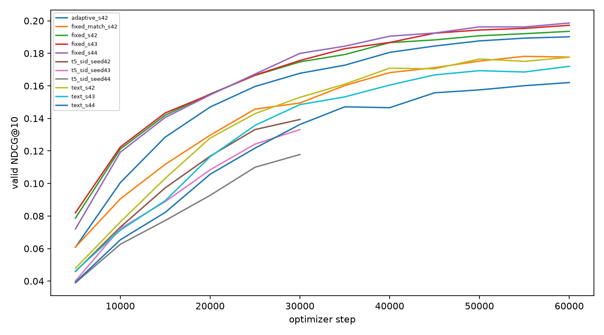

# 🔎 训练与搜索诊断

| 文件 | 内容 |
|---|---|
| [training_curves.png](training_curves.png) / [CSV](training_curves.csv) | 旧三种子、本周四组 seed42，以及 Text / Fixed 的 seed43、44，共 11 个运行、114 个验证点 |
| [search_diagnosis.md](search_diagnosis.md) | 固定 512 名验证用户上的 Beam 与全目录精确打分对比 |
| `historical_30k_s42_valid_*_n512.json` | 五种搜索方法的完整指标、用户列表与 checkpoint 哈希 |
| `historical_30k_s42_valid_*_n512_samples.json` | 各方法前 20 名用户的推荐示例 |
| `environment.json`、`*_sha256.txt` | 实验环境与冻结输入记录 |
| `cpu-smoke/` | 小模型前向、反向、保存和恢复记录 |

曲线排除冒烟与尚未完成的运行。旧模型训练 30,000 步，本周模型训练 60,000 步；两者也改变了输入构造和学习率日程，不能将差异只归因于训练步数。

搜索诊断使用旧 seed42 模型、同一批用户和完整历史屏蔽。Beam20 与 exact 的 Top-10 平均重合率为 90.61%；增大 Beam 可更接近模型的精确概率排序，但 NDCG 不保证单调提高。耗时是批处理测量，不是线上单请求延迟。

五份完整预测明细保留在服务器 `work/week7/predictions/`。所有方法均通过 Top-10 唯一性、目录合法性和历史屏蔽检查，仓库中的指标已由这些明细重算核对。
