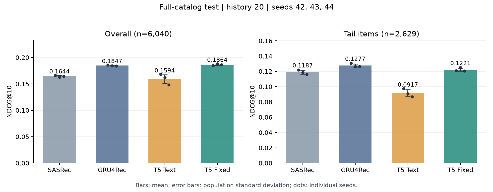

# 🎯 协同信号与语义标识符：最终结果

MovieLens 1M；6,040名用户、3,416部电影；历史长度20；全目录排序并屏蔽完整历史。训练种子42/43/44，报告均值与总体标准差（ddof=0）。

**T5 · Fixed相对Text的test NDCG@10提高约17.0%**；差值+0.027080，用户配对bootstrap 95%区间为[+0.022844, +0.031335]。候选仅按valid选择，test未用于调参。

## 同口径主表

| 模型 | Recall@5 | Recall@10 | NDCG@5 | NDCG@10 |
|---|---:|---:|---:|---:|
| SASRec | 0.1996 ± 0.0026 | 0.2876 ± 0.0010 | 0.1361 ± 0.0025 | 0.1644 ± 0.0014 |
| GRU4Rec | 0.2257 ± 0.0004 | 0.3115 ± 0.0010 | 0.1571 ± 0.0010 | 0.1847 ± 0.0007 |
| T5 · Text | 0.1949 ± 0.0105 | 0.2746 ± 0.0115 | 0.1337 ± 0.0080 | 0.1594 ± 0.0083 |
| T5 · Fixed | 0.2243 ± 0.0012 | 0.3151 ± 0.0039 | 0.1571 ± 0.0006 | 0.1864 ± 0.0014 |

相对GRU4Rec，候选的NDCG@10均值差为+0.001706，用户配对bootstrap 95%区间为[-0.002662, +0.005913]。区间包含0，当前结果不足以确认总体优于GRU4Rec。[原始统计](summaries/gru4rec_comparison.json)

误差线为三个训练种子的总体标准差，散点为各个种子；完整分组的四项指标见[test_results.csv](summaries/test_results.csv)。

## 三种子与分组

| 生成方案 | seed42 NDCG@10 | seed43 | seed44 |
|---|---:|---:|---:|
| T5 · Text | 0.168175 | 0.161643 | 0.148254 |
| T5 · Fixed | 0.184915 | 0.188319 | 0.186077 |

| 目标物品分组 | n | SASRec | GRU4Rec | Text | Fixed |
|---|---:|---:|---:|---:|---:|
| 总体 | 6040 | 0.1644 ± 0.0014 | 0.1847 ± 0.0007 | 0.1594 ± 0.0083 | 0.1864 ± 0.0014 |
| 少样本（频次≤20） | 72 | 0.0490 ± 0.0026 | 0.0531 ± 0.0081 | 0.0120 ± 0.0034 | 0.0297 ± 0.0081 |
| 长尾（后80%物品） | 2629 | 0.1187 ± 0.0024 | 0.1277 ± 0.0020 | 0.0917 ± 0.0044 | 0.1221 ± 0.0020 |
| 头部（前20%物品） | 3411 | 0.1996 ± 0.0024 | 0.2287 ± 0.0006 | 0.2115 ± 0.0116 | 0.2360 ± 0.0013 |
| 严格冷启动 | 0 | N/A | N/A | N/A | N/A |

分组表为NDCG@10。分组由目标物品的train频次定义；少样本组包含在长尾组内，不应相加。

候选相对GRU4Rec的均值差：头部+0.0073，长尾-0.0056，少样本-0.0234。总体比较应同时看分组结果。

## 四组表示的valid消融（seed42）

| 表示 | valid NDCG@10 |
|---|---:|
| Text | 0.177611 |
| Fixed | 0.193518 |
| Fixed-Match | 0.178134 |
| Adaptive | 0.190177 |

按valid冻结T5 · Fixed，随后补齐它与Text的三个训练种子。Adaptive未在该筛选中超过Fixed；Fixed-Match只匹配平均协同强度。单seed结果不足以确定频次分配策略的稳定收益或失败原因。

## 结论与适用边界

- 协同信号在量化前进入物品ID；Text与候选使用相同的模型、训练预算和解码设置。前缀协同相似度的变化提供描述性证据，不能单独证明收益机制。
- 主指标同时报告候选相对Text与GRU4Rec的用户配对区间。数据、历史与评价口径对齐，不代表不同架构的参数量和计算预算完全相同。
- 配对bootstrap执行10,000次用户重采样，固定当前三个已训练模型。它描述用户抽样不确定性，训练波动另看种子标准差。
- 仅验证一个数据集、三个推荐模型训练种子；量化种子固定42。少样本test仅72人，严格冷启动n=0，记为N/A。
- 固定训练预算不等于充分收敛，需结合[训练轨迹](../05-formal-training/README.md)和[量化质量](../03-semantic-ids/README.md)判断。旧30k与新60k还同时改变学习率轨迹和表示设置，未单独归因训练步数。
- 搜索诊断使用旧checkpoint与固定512名valid用户；exact是模型概率排序参考，不是NDCG上界。离线指标与批处理耗时不能替代生产系统的在线效果、延迟与成本验证。

## 历史配置参考

Week 1–6的h200基线NDCG@10为SASRec 0.1637±0.0034、GRU4Rec 0.1882±0.0009；旧h20生成模型为0.1180±0.0092。历史配置的选模口径与本周存在差异，该结果只作配置效果参考，不用于推断架构优劣。
